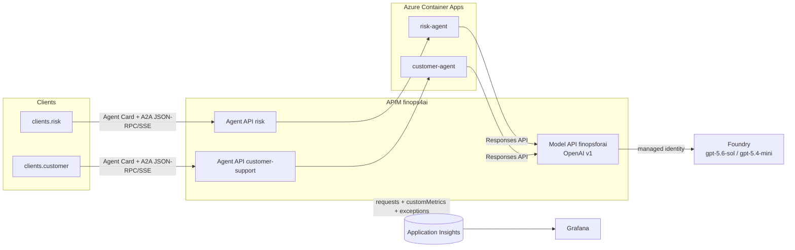
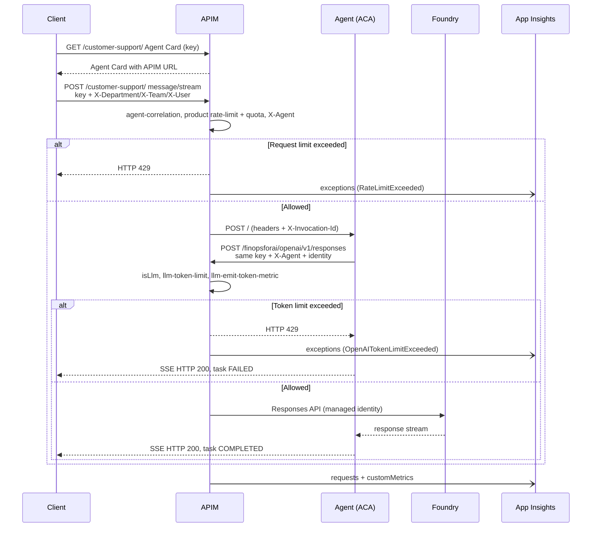

# FinOps for AI demo architecture on Azure API Management

This document describes how the demo is built. Two A2A agents run on Azure
Container Apps, and two model deployments run on Microsoft Foundry. Both layers
are published through a single Azure API Management (APIM) instance. APIM
enforces per-product limits and quotas, emits token metrics, and sends
telemetry to Application Insights. A Grafana dashboard queries that data.

All names, URLs, and values refer to the demo environment. This document
contains no real identities or subscription keys.

## Contents

1. [Overview](#1-overview)
2. [Agents on Azure Container Apps](#2-agents-on-azure-container-apps)
3. [Onboarding the A2A agents in APIM](#3-onboarding-the-a2a-agents-in-apim)
4. [Foundry models through APIM](#4-foundry-models-through-apim)
5. [Products, rate limits, and quotas](#5-products-rate-limits-and-quotas)
6. [Identities, users, and subscriptions](#6-identities-users-and-subscriptions)
7. [Test clients](#7-test-clients)
8. [Telemetry in Application Insights](#8-telemetry-in-application-insights)
9. [Grafana dashboard](#9-grafana-dashboard)
10. [End-to-end request flow](#10-end-to-end-request-flow)
11. [Checks and common issues](#11-checks-and-common-issues)
12. [Limitations and recommendations](#12-limitations-and-recommendations)

## 1. Overview



| Component | Demo resource |
| --- | --- |
| APIM instance | `finops4ai` (`https://finops4ai.azure-api.net`), Sweden Central |
| Resource group | `finops-for-ai-rg` |
| Agents | Container Apps `risk-agent` and `customer-agent` |
| Models | Foundry account `finopsforai` (`https://finopsforai.services.ai.azure.com/`) |
| Telemetry | Application Insights `finops4aiappsins` |
| Visualization | Grafana dashboard UID `ai-tokens-consumption` |

Design principles:

- **All traffic goes through APIM**, both client -> agent and agent -> model.
- **A single subscription key** identifies the user on both hops. The agent
  forwards it to the model, so APIM applies the same product's policies.
- **APIM sets the agent identity** (`X-Agent`), not the client.
- **All telemetry comes from APIM.** Token metrics, requests, and errors are
  sent by the gateway to a single Application Insights resource. The Container
  Apps are not connected to Application Insights.

## 2. Agents on Azure Container Apps

The agents are two Python services built with **Microsoft Agent Framework**.
They expose the **A2A 1.0 JSON-RPC** protocol with SSE streaming. The code is in
[agents/](../agents/), and deployment is described in
[deployment/README.md](../deployment/README.md).

| Agent | Container App | APIM ID | Fictitious department | Model deployment | Load profile |
| --- | --- | --- | --- | --- | --- |
| Risk analysis | `risk-agent` | `risk` | CIB | `gpt-5.6-sol` | Few requests with very long documents |
| Customer support | `customer-agent` | `customer-support` | Retail | `gpt-5.4-mini` | Many short, concurrent requests |

Each Container App exposes:

- `GET /.well-known/agent-card.json`: the A2A Agent Card.
- `POST /`: A2A JSON-RPC, including `message/stream` over SSE.
- `GET /healthz`: liveness only; it does not check model access.

Relevant configuration in Azure:

| Variable | Value |
| --- | --- |
| `AUTH_MODE` | `managed_identity` |
| `RISK_OPENAI_BASE_URL` / `CUSTOMER_OPENAI_BASE_URL` | `https://finops4ai.azure-api.net/finopsforai/openai/v1` |
| `RISK_MODEL_DEPLOYMENT` | `gpt-5.6-sol` |
| `CUSTOMER_MODEL_DEPLOYMENT` | `gpt-5.4-mini` |
| `RISK_MAX_RETRIES` / `CUSTOMER_MAX_RETRIES` | `0`: the first final error is reported |
| `APPLICATIONINSIGHTS_CONNECTION_STRING` | Not configured: the agents don't send telemetry to Application Insights |

The model URL points to **APIM**, not directly to Foundry. The agent
authenticates with its managed identity and Entra ID; it does not use model API
keys.

### Headers the agent forwards to the model

For each A2A execution, the agent copies these incoming headers to that
request's model call only:

| Header | Source | Purpose |
| --- | --- | --- |
| `X-Agent` | A2A API policy in APIM | `agent` metric dimension |
| `X-Department`, `X-Team`, `X-User` | Client, from the identities CSV | Organizational dimensions |
| `Ocp-Apim-Subscription-Key` | Client, fourth CSV column | Selects the APIM subscription and product |
| `X-Invocation-Id` | APIM `agent-correlation` fragment | Correlates errors with the A2A request |
| `X-Model-Call-Id` | Generated by the agent | Identifies the logical model call |

`Authorization`, `X-Product-Id`, and `X-Subscription-Id` are **not** forwarded.
APIM resolves the product and subscription from the key. The key is never
written to logs.

## 3. Onboarding the A2A agents in APIM

The agents were imported as **A2A APIs** from their Agent Cards, following
[Import an A2A agent API](https://learn.microsoft.com/azure/api-management/agent-to-agent-api).

| APIM API | Type | Path | Agent ID | Backend Agent Card | Subscription |
| --- | --- | --- | --- | --- | --- |
| `risk` | `a2a` | `/risk` | `risk` | `https://risk-agent.<environment>.azurecontainerapps.io/.well-known/agent-card.json` | Required |
| `customer-support` | `a2a` | `/customer-support` | `customer-support` | `https://customer-agent.<environment>.azurecontainerapps.io/.well-known/agent-card.json` | Required |

Both APIs belong to the `free`, `standard`, and `premium` products.

### A2A API policy

Each A2A API has this policy; only the `agent-id` value changes:

```xml
<policies>
    <inbound>
        <include-fragment fragment-id="agent-correlation" />
        <base />
        <set-variable name="agent-id" value="risk" />
        <set-header name="X-Agent" exists-action="override">
            <value>@((string)context.Variables["agent-id"])</value>
        </set-header>
    </inbound>
    <backend>
        <base />
    </backend>
    <outbound>
        <base />
    </outbound>
    <on-error>
        <base />
    </on-error>
</policies>
```

- APIM **overrides** `X-Agent`, so a client cannot impersonate an agent.
- `agent-correlation` is included **before `<base/>`**, so the identifier
  already exists even if the product rejects the request.

The [apim-agent-correlation.xml](../deployment/apim-agent-correlation.xml) fragment:

```xml
<fragment>
    <set-header name="X-Invocation-Id" exists-action="override">
        <value>@(context.RequestId.ToString())</value>
    </set-header>
    <set-header name="X-Apim-Service-Id" exists-action="override">
        <value>@(context.Deployment.ServiceId)</value>
    </set-header>
</fragment>
```

`X-Invocation-Id` matches `customDimensions["Request Id"]` of the A2A request in
`requests`. The fragment is **not** included in the model API, so it doesn't
replace the original invocation identifier.

### Discovery APIs with a rewritten Agent Card

The Agent Card that the native A2A API publishes at `/<agent>/agent-card.json`
updates `url`, but keeps the Container App URL in `supportedInterfaces`. A2A 1.0
clients use `supportedInterfaces`, so they would **bypass APIM**.

To avoid that, two HTTP discovery APIs were created:

| APIM API | Path | Operation | Own subscription |
| --- | --- | --- | --- |
| `risk-discovery` | `/risk-discovery` | `GET /agent-card.json` | No |
| `customer-support-card` | `/customer-support-discovery` | `GET /agent-card.json` | No |

The operation calls the A2A API's Agent Card through the gateway itself and
rewrites the advertised URL:

```xml
<policies>
    <inbound>
        <base />
        <set-backend-service base-url="https://finops4ai.azure-api.net" />
        <rewrite-uri template="/risk/agent-card.json" copy-unmatched-params="false" />
    </inbound>
    <backend>
        <base />
    </backend>
    <outbound>
        <base />
        <choose>
            <when condition="@(context.Response.StatusCode == 200)">
                <set-body>@{
                    var card = context.Response.Body.As<JObject>();
                    card["supportedInterfaces"] = new JArray(
                        new JObject(
                            new JProperty("url", "https://finops4ai.azure-api.net/risk/"),
                            new JProperty("protocolBinding", "JSONRPC"),
                            new JProperty("protocolVersion", "1.0")
                        )
                    );
                    card["url"] = "https://finops4ai.azure-api.net/risk/";
                    return card.ToString(Newtonsoft.Json.Formatting.None);
                }</set-body>
                <set-header name="Content-Type" exists-action="override">
                    <value>application/json</value>
                </set-header>
                <set-header name="ETag" exists-action="delete" />
                <set-header name="Content-MD5" exists-action="delete" />
            </when>
        </choose>
    </outbound>
    <on-error>
        <base />
    </on-error>
</policies>
```

`customer-support-card` is identical, with `/risk/` replaced by
`/customer-support/`. The discovery API doesn't require a subscription, but the
internal call to the A2A API does. The client sends its
`Ocp-Apim-Subscription-Key`, and APIM forwards it.

> **Important:** always configure the clients with the discovery URL. If
> `https://finops4ai.azure-api.net/customer-support/agent-card.json` is used,
> the client calls the Container App directly. Rate limits aren't applied,
> `X-Agent` isn't set, and model metrics show `agent=N/A`.

## 4. Foundry models through APIM

The Foundry deployments are published through a single **OpenAI v1**-compatible
API:

| Item | Value |
| --- | --- |
| APIM API | `finopsforai` |
| Path | `/finopsforai` |
| Base URL used by the agents | `https://finops4ai.azure-api.net/finopsforai/openai/v1` |
| Operation used | `POST /openai/v1/responses` (Responses API) |
| Backend | `finopsforai-ai-endpoint` -> `https://finopsforai.services.ai.azure.com/` |
| APIM -> Foundry authentication | APIM managed identity, resource `https://cognitiveservices.azure.com/` |
| Subscription | Required, `Ocp-Apim-Subscription-Key` header |
| Products | `free`, `standard`, `premium` |

| Deployment | Used by |
| --- | --- |
| `gpt-5.6-sol` | `risk` |
| `gpt-5.4-mini` | `customer-support` |

The agent selects the model in the request body's `model` field. APIM extracts
it to use as a dimension.

### Model API policy

```xml
<policies>
    <inbound>
        <set-variable name="isLlm" value="@(true)" />
        <base />
        <set-variable name="requestedModel" value="@{
            var body = context.Request.Body.As<JObject>(preserveContent: true);
            var model = body["model"];
            return model != null && model.Type == JTokenType.String
                ? model.Value<string>()
                : string.Empty;
        }" />
        <llm-emit-token-metric namespace="FinOpsForAI">
            <dimension name="model" value="@((string)context.Variables["requestedModel"])" />
            <dimension name="subscriptionId" value="@(context.Subscription.Id)" />
            <dimension name="product" value="@(context.Product.Id)" />
            <dimension name="agent" value="@(context.Request.Headers.GetValueOrDefault("X-Agent", ""))" />
            <dimension name="user" value="@(context.Request.Headers.GetValueOrDefault("X-User", ""))" />
            <dimension name="team" value="@(context.Request.Headers.GetValueOrDefault("X-Team", ""))" />
            <dimension name="department" value="@(context.Request.Headers.GetValueOrDefault("X-Department", ""))" />
        </llm-emit-token-metric>
        <set-backend-service id="apim-generated-policy" backend-id="finopsforai-ai-endpoint" />
    </inbound>
    <backend>
        <base />
    </backend>
    <outbound>
        <base />
    </outbound>
    <on-error>
        <base />
    </on-error>
</policies>
```

- `isLlm` is set **before `<base/>`**, so the product policy knows it's running
  on the model API.
- `llm-emit-token-metric` emits token metrics to the `FinOpsForAI` namespace:
  prompt, completion, total, cache, and reasoning. They carry the `model`,
  `subscriptionId`, `product`, `agent`, `user`, `team`, and `department`
  dimensions.
- `agent`, `user`, `team`, and `department` come from the headers forwarded by
  the agent. If a header is missing, Application Insights shows `N/A`.
- For the metrics to reach `customMetrics`, the API's `applicationinsights`
  diagnostic has **metrics enabled**.

## 5. Products, rate limits, and quotas

There are three published products. All require a subscription and don't need
approval: `free`, `standard`, and `premium`. All three contain the `risk` and
`customer-support` A2A APIs and the `finopsforai` model API.

Because the agent forwards the same key, **a single subscription governs both
hops**. The product policy uses `isLlm` to tell the calls apart:

- If `isLlm` is `true` (model API), `llm-token-limit` applies: tokens per
  minute and a daily token quota.
- Otherwise (A2A APIs), `rate-limit` and `quota` apply to the **number of
  requests**.

`premium` product policy:

```xml
<inbound>
    <base />
    <choose>
        <when condition="@(context.Variables.GetValueOrDefault<bool>("isLlm", false))">
            <llm-token-limit id="limit-llm-tokens"
                counter-key="@("llm-" + context.Subscription.Id)"
                tokens-per-minute="100000"
                token-quota="10000000" token-quota-period="Daily"
                estimate-prompt-tokens="true"
                remaining-tokens-variable-name="remainingTokens"
                remaining-quota-tokens-variable-name="remainingQuotaTokens" />
        </when>
        <otherwise>
            <rate-limit id="limit-agent-requests" calls="30" renewal-period="60"
                remaining-calls-header-name="X-RateLimit-Remaining"
                total-calls-header-name="X-RateLimit-Limit" />
            <quota id="quota-agent-requests" calls="20000" renewal-period="86400" />
        </otherwise>
    </choose>
</inbound>
```

`standard` and `free` use the same structure with lower limits:

| Product | Tokens/minute (model) | Daily token quota (model) | Requests/minute (agents) | Requests/day (agents) |
| --- | ---: | ---: | ---: | ---: |
| `premium` | 100,000 | 10,000,000 | 30 | 20,000 |
| `standard` | 20,000 | 1,000,000 | 10 | 5,000 |
| `free` | 6,000 | 100,000 | 5 | 1,000 |

Notes:

- Counters apply **per subscription**. The A2A limit is shared by both agents,
  because `rate-limit` and `quota` count per subscription. The token
  `counter-key` uses an `llm-` prefix to keep it separate.
- `estimate-prompt-tokens="true"` lets APIM reject a call before it reaches the
  model, using an estimate of the input tokens.
- When a **per-minute** limit (`rate-limit` or `tokens-per-minute`) is
  exceeded, APIM returns **HTTP 429**. When a **quota** (`quota` or
  `token-quota`) is exhausted, it returns **HTTP 403**. Each policy's `id`
  attribute identifies the source in traces and in `context.LastError.PolicyId`.
- A model 429 **doesn't reach the A2A client as a 429**. Once the SSE stream is
  open, the agent returns HTTP 200 and the task ends as `FAILED`. See
  [section 8](#8-telemetry-in-application-insights).

## 6. Identities, users, and subscriptions

The test identities are synthetic. They're defined in a CSV without a header:

```csv
department,team,email
```

Fictitious example:

```csv
finance,globalrisk,ana@contoso.com
retail,cards,luis@contoso.com
```

> **Note: identity headers are a testing simplification.** The clients send
> `X-User`, `X-Department`, and `X-Team` as plain headers for simplicity. That
> way, load tests can simulate many users without obtaining a valid token for
> each one. These headers are not authenticated: any caller can set any value.
>
> Ideally, the client sends a **JWT** (for example, an Entra ID access token)
> when it calls the agent. APIM validates the token on the A2A API and derives
> the identity from its claims. Then it **overrides** the headers, so values
> sent by the client are ignored:
>
> ```xml
> <validate-jwt header-name="Authorization" output-token-variable-name="jwt"
>     failed-validation-httpcode="401">
>     <openid-config url="https://login.microsoftonline.com/<tenant-id>/v2.0/.well-known/openid-configuration" />
>     <audiences>
>         <audience>api://<agent-app-id></audience>
>     </audiences>
> </validate-jwt>
> <set-header name="X-User" exists-action="override">
>     <value>@(((Jwt)context.Variables["jwt"]).Claims.GetValueOrDefault("preferred_username", ""))</value>
> </set-header>
> <set-header name="X-Department" exists-action="override">
>     <value>@(((Jwt)context.Variables["jwt"]).Claims.GetValueOrDefault("department", ""))</value>
> </set-header>
> <set-header name="X-Team" exists-action="override">
>     <value>@(((Jwt)context.Variables["jwt"]).Claims.GetValueOrDefault("team", ""))</value>
> </set-header>
> ```
>
> In this example, `department` and `team` are not default Entra ID claims.
> Emit them as optional or custom claims, for example from directory extension
> attributes. You can also map them from `groups` or app roles. The agent keeps
> forwarding the resulting headers to the model API, so the token metrics and
> dashboard work without changes. In that setup, the subscription key still
> selects the product, and the JWT identifies the user.

For each email, the [onboard_apim_users.py](../deployment/onboard_apim_users.py)
script:

1. Creates or reuses an **APIM user**.
2. With `--subscriptions "premium, standard, free"`, creates **one subscription
   per user**, randomly assigned to one of the products (reproducible with
   `--seed`).
3. Retrieves the primary key and writes a new `<input>.subs` file with a fourth
   column:

   ```csv
   department,team,email,subscription_key
   ```

```bash
export AZURE_SUBSCRIPTION_ID="<subscription-id>"
export RESOURCE_GROUP="finops-for-ai-rg"
export APIM_NAME="finops4ai"

uv run python -m deployment.onboard_apim_users \
  clients/data/identities.csv \
  --subscriptions "premium, standard, free" --seed 42 --dry-run

uv run python -m deployment.onboard_apim_users \
  clients/data/identities.csv \
  --subscriptions "premium, standard, free" --seed 42
```

`*.csv.subs` files contain secrets. They're excluded from Git and must not be
shared. Rerun and error handling details are in
[deployment/README.md](../deployment/README.md#usuarios-y-subscriptions-de-apim).

## 7. Test clients

There are two streaming A2A clients: `clients.risk` and `clients.customer`. Each
one needs the URL of its **discovery Agent Card**:

```bash
RISK_AGENT_CARD_URL=https://finops4ai.azure-api.net/risk-discovery/agent-card.json
CUSTOMER_AGENT_CARD_URL=https://finops4ai.azure-api.net/customer-support-discovery/agent-card.json
```

With `--identities-file`, each request sends the headers from one CSV row:

| Header | Column |
| --- | --- |
| `X-Department` | `department` |
| `X-Team` | `team` |
| `X-User` | `email` |
| `Ocp-Apim-Subscription-Key` | `subscription_key` |

The client **does not send `X-Agent`**; APIM adds it. The identity headers are
a testing shortcut instead of per-user JWTs; see the note in
[section 6](#6-identities-users-and-subscriptions).

```bash
# Single request
uv run python -m clients.customer \
  --prompt "I lost my card, what should I do?" \
  --identities-file clients/data/identities.csv.subs

# Random load: random identities, reproducible
uv run python -m clients.customer --random --requests 100 --concurrency 8 \
  --identities-file clients/data/identities.csv.subs \
  --identity-mode random --seed 42 --output results/customer.jsonl

# Long documents: identities in sequence
uv run python -m clients.risk --random --requests 3 --concurrency 1 \
  --document-sections 60 \
  --identities-file clients/data/identities.csv.subs \
  --identity-mode sequence --output results/risk.jsonl
```

- `--identity-mode sequence` walks the rows in order; `random` picks one at
  random for each request.
- To trigger rejections, use identities from the `free` product with higher
  concurrency or long documents.
- The `--output` JSONL stores status, latencies and, on failure, `error` and
  `error_details` (origin, upstream HTTP status, and `invocation_id`).

**These tests make real calls and incur billable usage.** See all options in
the [main README](../README.md#3-clientes-python-a2a-streaming).

## 8. Telemetry in Application Insights

APIM has a `finops4aiappsins` logger (Application Insights) and diagnostics with
100% sampling. All three tables used below are populated by APIM; the agents
don't send telemetry.

### `customMetrics`: token usage

Emitted by `llm-emit-token-metric` on the model API.

| Field | Content |
| --- | --- |
| `name` | `Prompt Tokens`, `Completion Tokens`, `Total Tokens`, `Prompt Cached Tokens`, `Completion Reasoning Tokens`, etc. |
| `valueSum` | Tokens in the pre-aggregated interval |
| `customDimensions.model` | Deployment: `gpt-5.6-sol`, `gpt-5.4-mini` |
| `customDimensions.agent` | `risk`, `customer-support` |
| `customDimensions.product` | `free`, `standard`, `premium` |
| `customDimensions.subscriptionId` | APIM subscription ID |
| `customDimensions.department`, `team`, `user` | Identity sent by the client |

Example `customDimensions`, with fictitious values:

```json
{
  "agent": "customer-support",
  "model": "gpt-5.4-mini",
  "product": "free",
  "subscriptionId": "demo-sub-xxxxxxxx",
  "department": "finance",
  "team": "globalrisk",
  "user": "ana@contoso.com",
  "Service Name": "finops4ai",
  "Region": "Sweden Central"
}
```

```kusto
customMetrics
| where timestamp > ago(24h) and name == "Total Tokens"
| summarize Tokens = sum(todouble(valueSum))
    by agent = tostring(customDimensions.agent),
       model = tostring(customDimensions.model),
       product = tostring(customDimensions.product)
| order by Tokens desc
```

Metrics are **pre-aggregated**: always sum `valueSum`; don't count rows.
Don't add `Total Tokens` to prompt and completion tokens, or you'll count twice.

### `requests`: requests and rejections in APIM

Each gateway request produces one row. `customDimensions["API Type"]`
distinguishes the layers:

| `API Type` | What it is | Useful dimensions | An HTTP 429 means (demo convention) |
| --- | --- | --- | --- |
| `a2a` | Agent requests | `API Name`, `gen_ai.agent.id`, `Product Name`, `Subscription Name`, `Operation Name` (`jsonrpc-base`, `agent-card-get`) | Product `request-rate-limit` |
| `http` | Model requests (`finopsforai`) and discovery | `API Name`, `Operation Name` (`createResponse`) | `llm-rate-limit` (`llm-token-limit`) |

- `Subscription Name` in `requests` has the same value as `subscriptionId` in
  `customMetrics`, and `gen_ai.agent.id` matches `agent`. The dashboard uses
  those keys to attribute A2A requests to users.
- A `resultCode` of `200 [not sent in full ...]` indicates an SSE stream that
  was cut off.
- `success` is a string in Application Insights; convert it with `tobool()`.

```kusto
requests
| where timestamp > ago(24h)
| where tostring(customDimensions["HTTP Method"]) == "POST"
| extend apiType = tostring(customDimensions["API Type"]),
         product = tostring(customDimensions["Product Name"])
| summarize Total = sum(itemCount), Rejected429 = sumif(itemCount, resultCode == "429")
    by apiType, api = tostring(customDimensions["API Name"]), product
| extend Pct429 = round(100.0 * Rejected429 / Total, 2)
```

### `exceptions`: APIM gateway errors

In this deployment, all rows in `exceptions` come from **APIM**
(`cloud_RoleName = "finops4ai Sweden Central"`). The gateway writes one
exception for each request that a policy rejects or that fails in transit. The
`type` field names the exact cause, so it tells apart a request rate limit
from a token limit even though both return HTTP 429:

| `type` | Layer (`API Type`) | HTTP | Meaning |
| --- | --- | --- | --- |
| `RateLimitExceeded` | `a2a` | 429 | Product `rate-limit` on agent requests |
| `OpenAITokenLimitExceeded` | `http` (model) | 429 | `llm-token-limit`: tokens per minute or the token quota exceeded |
| `TokenLimitExceededAfterPrompt` | `http` (model) | 429 | `llm-token-limit`: the estimated prompt tokens alone exceed the limit |
| `SubscriptionKeyNotFound`, `SubscriptionKeyInvalid` | Any | 401 | Missing or invalid subscription key |
| `OperationNotFound` | Any | 404 | No matching API operation |
| `ClientConnectionFailure` | Any | `200 [not sent in full ...]` | The caller closed the connection during the response, typically an SSE stream |

These are the types observed so far in this deployment. A daily request
`quota` hasn't been exhausted yet, so its exception type hasn't been recorded.
Join with `requests` on `operation_Id` to add the API, product, and
subscription:

```kusto
exceptions
| where timestamp > ago(24h)
| join kind=leftouter (
    requests
    | where timestamp > ago(24h)
    | project operation_Id, resultCode,
              apiType = tostring(customDimensions["API Type"]),
              api = tostring(customDimensions["API Name"]),
              product = tostring(customDimensions["Product Name"]),
              subscription = tostring(customDimensions["Subscription Name"])
  ) on operation_Id
| summarize Errors = count() by type, apiType, api, product, resultCode
| order by Errors desc
```

A rejected model call doesn't change the A2A response. The agent has already
opened the SSE stream with HTTP 200, so the client receives the A2A task as
`FAILED`. APIM records the model rejection (`OpenAITokenLimitExceeded`) on the
model API request, but nothing in Application Insights marks the A2A request
as failed. The client sees the failure in its JSONL output.

### Optional: agent-side failure export (not enabled)

The agent code can also export **one sanitized exception per failed
invocation**, to link a model rejection to the A2A request that it broke.
This isn't enabled in the current deployment: the Container Apps have no
`APPLICATIONINSIGHTS_CONNECTION_STRING`. If enabled, the records would carry
these fields:

| `customDimensions` | Content |
| --- | --- |
| `event` | `agent_invocation_failed` |
| `invocation_id` | Equals `requests["Request Id"]` of the A2A request |
| `correlation_source` | `header` (from APIM) or `generated` (no correlation) |
| `service`, `agent`, `model` | Execution context |
| `department`, `team`, `user` | Received identity |
| `error_origin` | `model` or `agent` |
| `error_kind` | `rate_limit`, `quota`, `forbidden`, `timeout`, `server_error`, ... |
| `upstream_status` | HTTP status returned by the model, if any |
| `retryable`, `retry_after_seconds`, `partial_output` | Failure details |

Prompts, error bodies, keys, and tokens would never be exported. Product and
subscription would come from joining with `requests` on service and
`invocation_id`. The `agent-correlation` fragment is already applied on the
A2A APIs, so only the agent side is missing.

To enable it, set `APPLICATIONINSIGHTS_CONNECTION_STRING` on both Container
Apps to the same Application Insights resource that APIM uses. Then rebuild and
redeploy images that include this code. See
[deployment/README.md](../deployment/README.md#excepciones-y-correlacion-con-apim).

## 9. Grafana dashboard

[tokens-consumption.json](../dashboards/grafana/tokens-consumption.json),
UID `ai-tokens-consumption`, is a single dashboard. It uses the **Azure
Monitor** data source in **Logs** mode against the Application Insights
resource:

```text
/subscriptions/<subscription-id>/resourceGroups/finops-for-ai-rg/providers/Microsoft.Insights/components/finops4aiappsins
```

| Section | Source | What it shows |
| --- | --- | --- |
| Token usage summary | `customMetrics` | Total tokens, input/output, trends, and a daily table |
| A2A access and rejections | `requests` (`a2a`) | Agent requests, `request-rate-limit` 429s, and percentage |
| Model access and LLM limits | `requests` (`http`) | Model requests, `llm-rate-limit` 429s, and a cross-layer comparison |
| Physical errors and affected invocations | `requests` + `exceptions` | 429s per layer and, once agent-side export is enabled, failures inside HTTP 200 and unique affected invocations |
| Products and subscriptions | All three | Tokens and rejections per product/subscription |
| Organizational breakdown | `customMetrics` + `requests` | Agents, departments, and teams |
| Users | `customMetrics` + `requests` | Top N users by usage and rejections |
| Data quality | All three | Missing dimensions, attribution, sampling, and correlation |

Section titles in the dashboard itself are in Spanish.

Cascading filters:

```text
service -> agent -> product -> subscriptionId -> department -> team -> user -> model
```

There are also **Top N** and **minimum requests for % rankings** controls.

How to read it:

- **Physical rejections and affected invocations are different things.** A
  model 429 counts as a rejected attempt in the model layer. The affected
  invocation panels use only agent-side exceptions
  (`event = agent_invocation_failed`), so they stay empty in the current
  deployment. APIM exceptions don't feed them.
- Each layer's 429 rate is divided by that layer's own requests.
- Identity for A2A requests is inferred from `customMetrics`, only when there's
  a single compatible context per service, agent, and subscription. Anything
  that can't be attributed is shown as such.
- `N/A` or `(sin dimension)` means a header was missing; for example, the call
  didn't go through APIM.

To import it, go to **Dashboards > New > Import**, upload the JSON, select the
Azure Monitor data source, and check the resource ID variable. To update it,
reimport and overwrite the same UID. To regenerate the JSON:

```bash
python3 dashboards/grafana/generate.py
```

More details are in [dashboards/grafana/README.md](../dashboards/grafana/README.md).

## 10. End-to-end request flow



## 11. Checks and common issues

| Symptom | Likely cause | Fix |
| --- | --- | --- |
| No A2A traffic in APIM, but model calls with `agent=N/A` | The client uses the native Agent Card and calls the Container App directly | Use the `*-discovery/agent-card.json` URLs |
| 401 when downloading the Agent Card | Missing subscription key | Use a `.subs` file with the fourth column |
| Empty `product`/`subscriptionId` in metrics | The agent doesn't forward the key, or the model API isn't in the product | Check key forwarding and the `finopsforai` API's products |
| Many 429s on `free` | Intentionally low limits | Use `standard`/`premium` or lower concurrency |
| `FAILED` task with HTTP 200 | Model error during the stream | Check APIM `exceptions` on the `finopsforai` API and the JSONL `error_details` |
| Many `ClientConnectionFailure` exceptions | Clients closed SSE streams early, for example on timeout | Review client timeouts; these aren't policy rejections |

To check where an Agent Card points:

```bash
curl -s -H "Ocp-Apim-Subscription-Key: $KEY" \
  https://finops4ai.azure-api.net/customer-support-discovery/agent-card.json \
  | jq '.supportedInterfaces'
```

It should return `https://finops4ai.azure-api.net/customer-support/`.

## 12. Limitations and recommendations

- **The Container Apps ingress is public.** Anyone who knows the URL can bypass
  APIM, its limits, and its telemetry. Outside the demo, restrict ingress to
  APIM (private networking, IP restrictions, or authentication).
- The client sends `X-Department`, `X-Team`, and `X-User`. **They are not a
  verified identity.** They're used only to simplify testing with many users.
  In production, APIM should derive them from a validated JWT and override
  them. See [section 6](#6-identities-users-and-subscriptions).
- Classifying a 429 by `API Type` is a convention of this environment. To know
  the exact policy, use policy `id` values and `context.LastError.PolicyId`.
- The A2A task store is in memory, with one replica per agent.
- No costs are calculated: the metrics are tokens, not billed amounts.
- Use synthetic data only, and never publish `.subs` files or connection
  strings.
